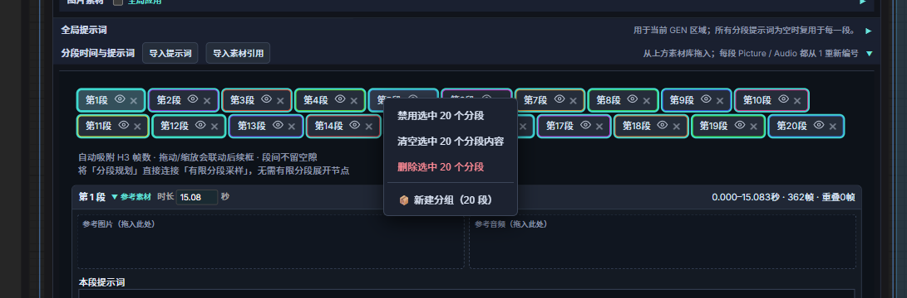
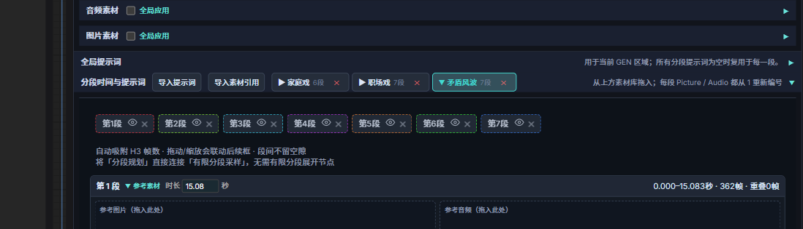
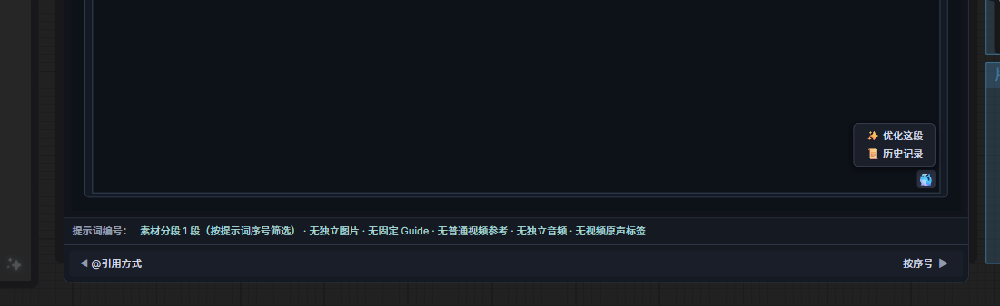
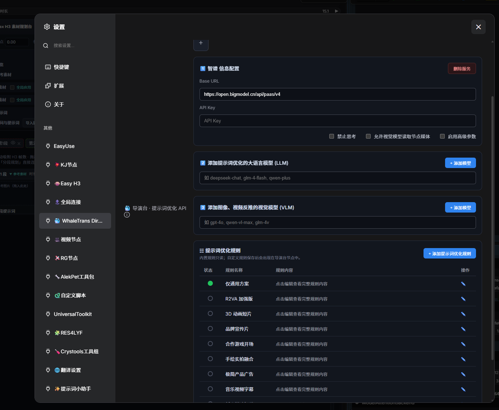
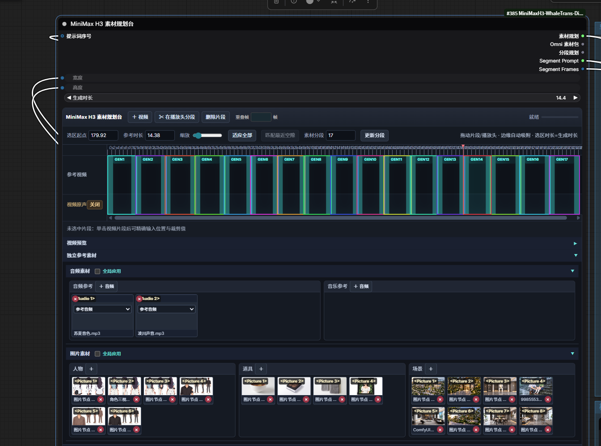
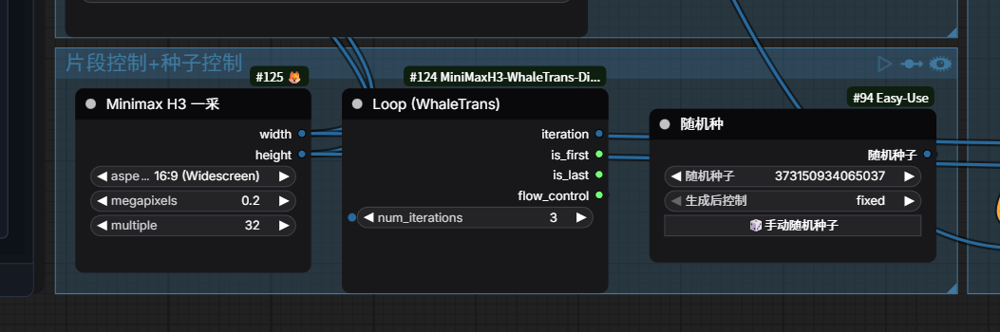
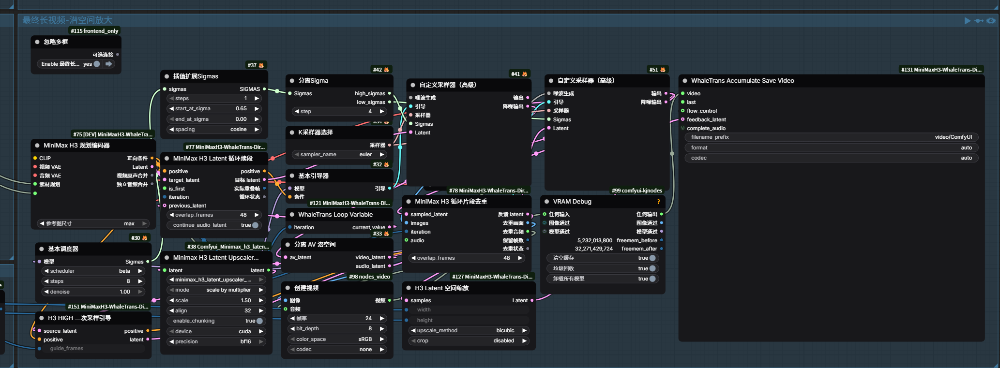
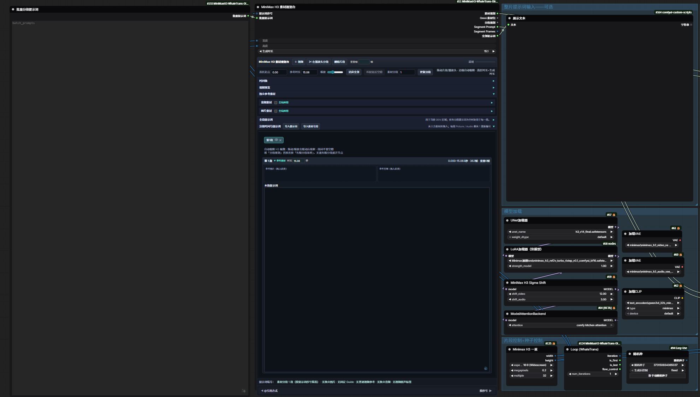

# ComfyUI MiniMax H3 WhaleTrans Director

English | [中文](README.md)

A UI-enhanced open-source plugin based on [Songssx/ComfyUI-MiniMaxH3-TimelineDirector](https://github.com/Songssx/ComfyUI-MiniMaxH3-TimelineDirector). Keeps all original timeline director features, adds **6 custom nodes** (3-node loop system + 3 utility nodes) and extensive UI improvements. The loop system uses ComfyUI's native **expand recursion** mechanism — works out of the box.

## 🎯 Design Philosophy

Built by a video creator, for real-world production workflows. Core focus: **playability and flexibility**.

When creating videos with MiniMax H3, I like experimenting with new nodes, sampling methods, and upscale models, combining different techniques into my own workflow. This plugin keeps timeline planning and multi-segment looping built-in, while everything else stays freely composable through the workflow graph.

## 🔥 v8.0 Major Update

JS grew from 1855 to 4108 lines, backend from 79KB to 103KB.

### Batch Segment Management

- **Batch prompt import**: Paste all segment prompts separated by `--- SEGMENT ---`, auto-fills in order
- **Box-select grouping**: Box-select multiple segments, right-click to create groups — folder-style management for long videos. Supports rename/ungroup/move segments
- **Batch enable/disable**: Eye icon toggle — run only selected segments for debugging





### Prompt Editing Enhancements

- **@mention menu**: Type @ to quickly insert media references (`<Picture N>` / `<Audio N>`)
- Double-click to rename/renumber, media categorized by character/prop/scene/audio/music



### Multi-Provider API + Custom Rules

- Built-in providers: Zhipu/xFlow/Ollama/Aliyun/DeepSeek/Doubao, plus custom OpenAI-compatible endpoints
- Each provider remembers its own URL, API key, and models — switch seamlessly
- 10 built-in optimization rules, support custom add/edit/delete, saved locally



### Audio & Looping

- Full-chain original audio lock — reference video soundtrack preserved
- Per-segment video export, auto-reset from segment 1 after interruption
- Global latent cache — no VRAM explosion on multi-segment runs

## 🖼️ UI Preview



## ✨ Features

- **3-node loop system**: Loop / LoopVariable / AccumulateSaveVideo — built-in, no third-party fusion needed
- **Native expand mechanism**: Uses ComfyUI's built-in recursion, no core file patching, survives ComfyUI updates
- **Memory optimization**: Global latent cache + key string references, avoids copying N large tensors
- **Run isolation**: Detects new runs, cleans up interrupted state, always starts from segment 1
- **H3 HIGH refine guide**: Fixes size mismatch after 3D latent upscale in director workflows
- **H3 latent resolution**: Reads pixel dimensions from H3 NestedTensor, compatible with regular latents
- **H3 latent shrink**: H3-specific latent resizing with NestedTensor support

## 📦 Installation

### Option 1: Releases (Recommended)

1. Download the latest zip from [Releases](https://github.com/jingyu000/ComfyUI-MiniMaxH3-WhaleTrans-Director/releases)
2. Extract to ComfyUI's `custom_nodes` directory
3. Restart ComfyUI

### Option 2: git clone

```bash
cd ComfyUI/custom_nodes
git clone https://github.com/jingyu000/ComfyUI-MiniMaxH3-WhaleTrans-Director.git
```

### Requirements

- ComfyUI 0.35.1+
- MiniMax H3 model
- **3D latent upscale model**: [LBH-123-AI/Minimax_h3_latent_Upscaler](https://huggingface.co/LBH-123-AI/Minimax_h3_latent_Upscaler) (~691MB fp16 recommended)
  - Place in `ComfyUI/models/latent_upscale_models/`
  - Supports 1.0x–4.0x continuous upscale, basic workflow uses 1.5x
- **3D latent upscale plugin**: [LBH-123-AI/Comfyui_Minimax_h3_latent_Upscaler](https://github.com/LBH-123-AI/Comfyui_Minimax_h3_latent_Upscaler)

## 🧩 Nodes

### Core Loop Nodes (3)



| Node | Description |
|------|-------------|
| `WhaleTransLoop` | Loop start, controls iteration count, outputs iteration/is_first/is_last/flow_control |
| `WhaleTransLoopVariable` | Passes latent variables between loop iterations (previous feedback latent) |
| `WhaleTransAccumulateSaveVideo` | Accumulates frames across iterations, triggers next loop expansion |

### Utility Nodes (3)

| Node | Description |
|------|-------------|
| `H3HighRefineGuide` | Injects upscaled latent as direct latent guide, fixes size mismatch for 2nd sampling |
| `H3LatentResolution` | Reads pixel dimensions from H3 NestedTensor (auto ×16 VAE downscale) |
| `H3LatentShrink` | H3-specific latent resizing, NestedTensor-compatible |

> All original author nodes are preserved (timeline director, material planner, plan encoder, Omni prompt bridge, loop prompt selector, loop latent guide, segment finalize, etc.).

## 📁 Example Workflows

| File | Description |
|------|-------------|
| `MiniMax循环长视频基础版示例工作流.json` | **Recommended starter**: multi-segment loop + two-pass sampling (LOW→3D upscale→HIGH refine→dedup→save) |

**Usage:** ComfyUI menu → `Load` → select the JSON file.

## 🎬 Basic Workflow Structure





```
Director (plan encoder) → Loop latent guide → CFG1 → Sampler (LOW)
                                                          ↓
                                              3D latent upscale (1.5x)
                                                          ↓
                                              H3 HIGH refine → CFG2 → Sampler (HIGH)
                                                          ↓
                                              Segment dedup → Accumulate save
                                                          ↓
                                                    (loop back)
```

## ❓ FAQ

**Q: Loop starts from middle after interruption?**
A: Fixed in v1.0+. Run isolation resets state automatically. Restart ComfyUI if needed.

**Q: `shape mismatch` error on 2nd sampling?**
A: Make sure the 2nd sampler's conditioning uses H3HighRefineGuide's output, not the loop guide directly.

**Q: High VRAM usage on long videos?**
A: Optimized with global latent cache. Use VRAM Debug node inside the loop to free intermediate memory.

## 📄 License

GPL v3 — see [LICENSE](LICENSE).

## 🙏 Acknowledgments

- Original author [Songssx](https://github.com/Songssx) — ComfyUI-MiniMaxH3-TimelineDirector
- [rattus128](https://github.com/rattus128) — generic-loops design inspiration
- [LBH-123-AI](https://huggingface.co/LBH-123-AI) — Minimax H3 Latent Upscaler model & plugin
- ComfyUI community, MiniMax H3 explorers
